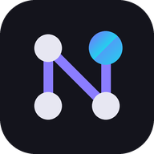
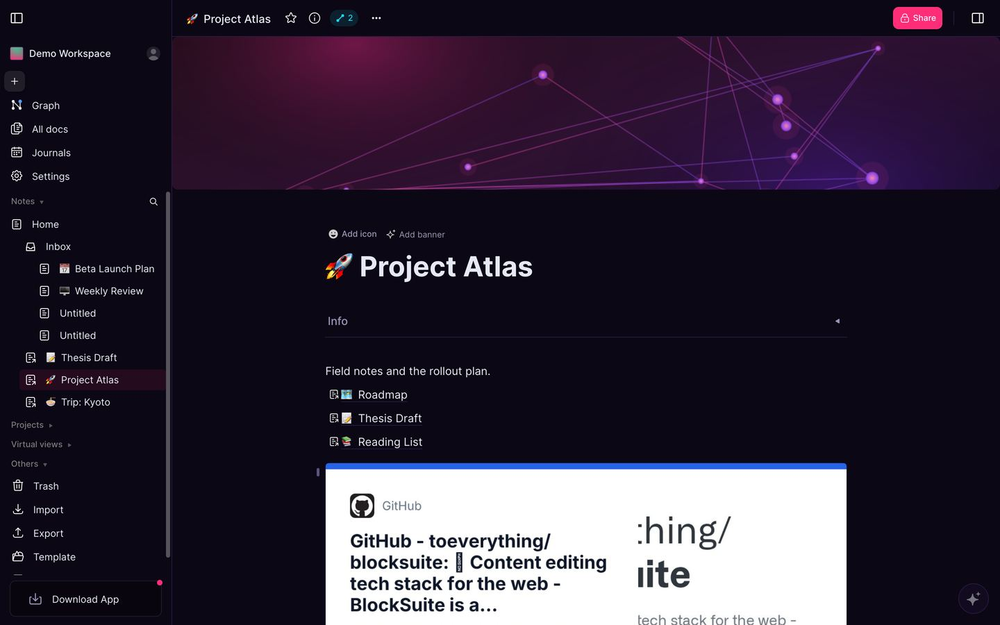
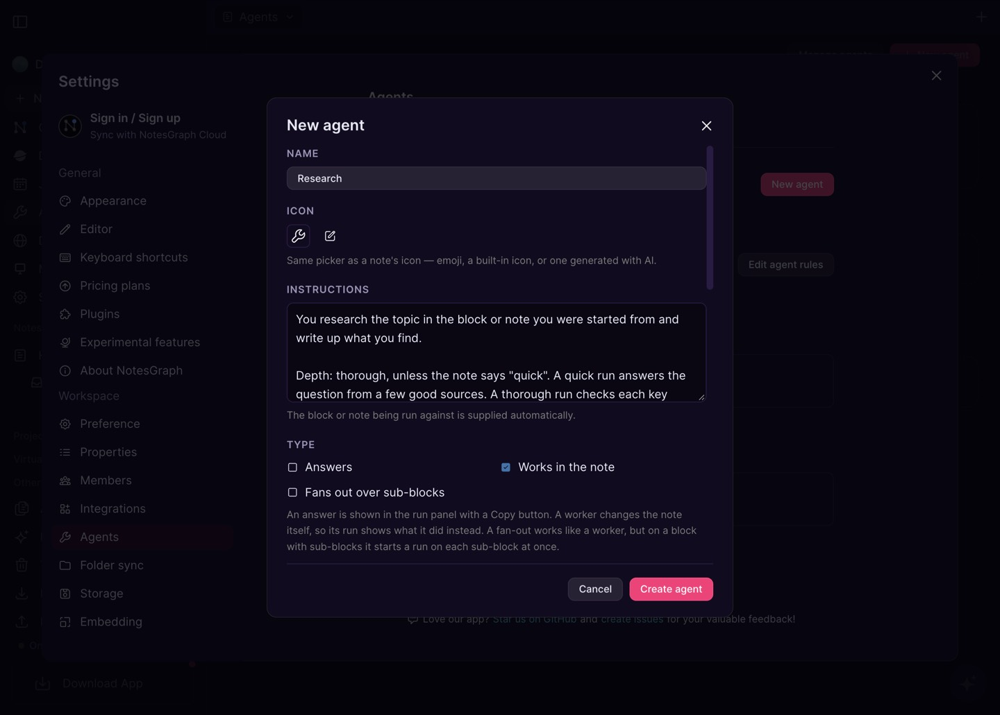
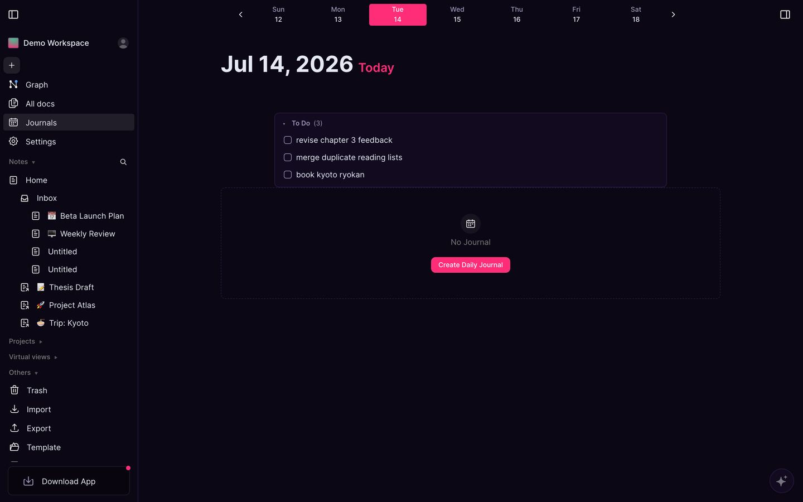
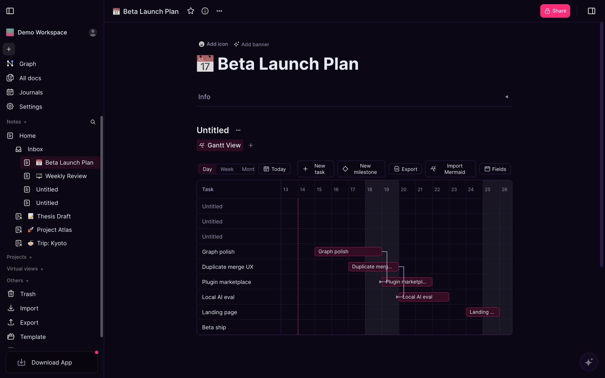
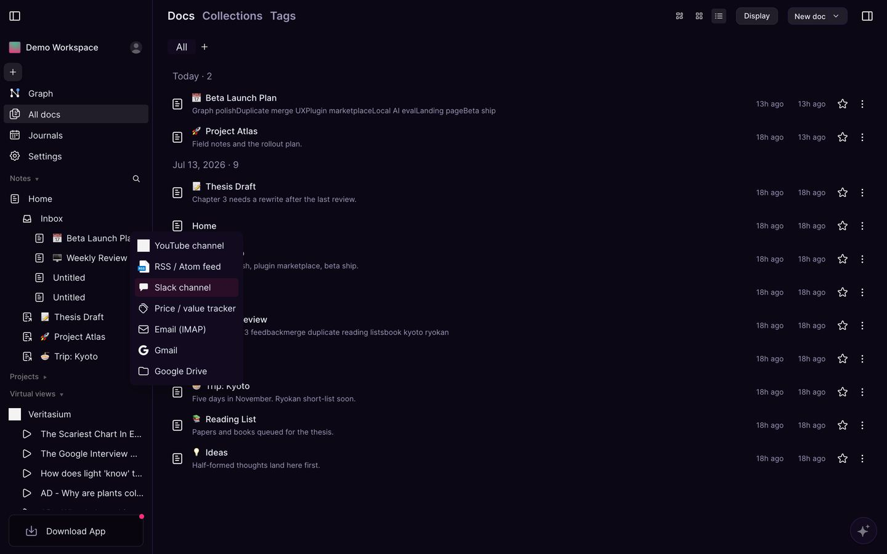
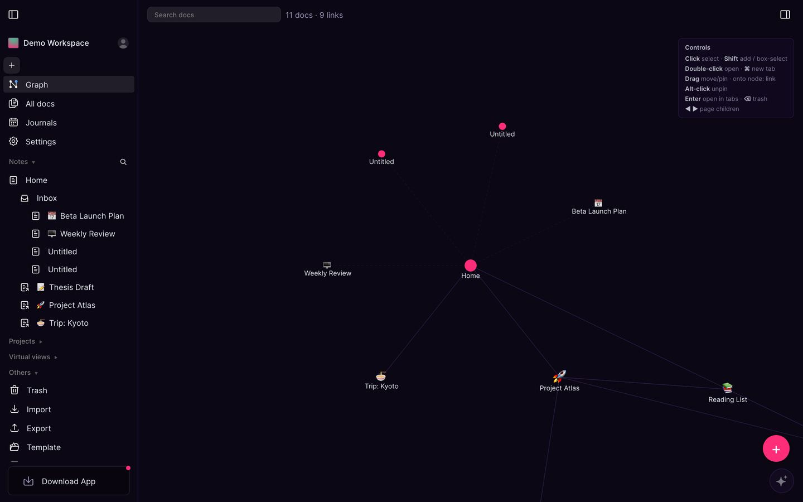

<div align="center">



# NotesGraph

**Notes. Tasks. Plans.**

A local-first notes app where AI agents work on your notes and tasks with you.
Built on [AFFiNE](https://github.com/toeverything/AFFiNE).

[Open the web app](https://app.notesgraph.com) · [Download](https://notesgraph.com/download) · [notesgraph.com](https://notesgraph.com)

</div>



## What it does

### Agents that work in your notes

An agent is a saved instruction you run on a block, a selection or a whole note: from the `/` menu, from
<kbd>Ctrl</kbd>/<kbd>⌘</kbd> <kbd>K</kbd> or from the Agents page.

- **Where it runs.** On the page in your browser, on the server, on a machine you've registered (Claude Code in
  a worktree of your repo), or as **Research**, with web search and page reading.
- **How it works.** An agent *answers*, *works in the note* (writes to it, ticks tasks) or *fans out*: on a block
  with sub-blocks it starts one run per sub-block, side by side. Task lists are claimed while an agent is on
  them, so two agents don't take the same task.
- **You stay in the loop.** Watch a run live, steer it while it works, and answer its questions. A finished
  run waits under **Needs you**:
  - **Approve** keeps what it did.
  - **Review changes** shows a summary, the notes it created and a diff of the files it changed.
  - **Ask** lets you question the run about what it did.
- **It learns your conventions.** Every run reads your *Agent rules* note. A note titled `Skill: <name>`
  becomes a skill your agents can use.
- **Templates to start from.** Research, Goal check, Deal monitor, Compile a source into my notes, a weekly
  Notes health check, and Fix it for failed health checks.



### Tasks, journals and plans

- **Each day gets a journal page**, with that day's calendar events (Google Calendar or CalDAV). You can
  open a note for any event.
- **Task lists roll up across your notes:** the journal gathers open to-dos from the whole workspace, and a
  project collects the tasks written under its heading in any note. Tasks take org-style statuses (`TODO`,
  `DOING`, `DONE`) and can be shown as a task board.
- **Blocks can carry dates and repeat rules**, and plans import from Mermaid into a Gantt view with
  dependencies and milestones.
- **Dashboards** put task and monitor charts side by side.

<table>
<tr>
<td width="50%"></td>
<td width="50%"></td>
</tr>
</table>

### Monitors and Monitoring

- **Monitors** keep a block up to date on a schedule: from a web page, a command or an agent run. The readings
  show as a sparkline on the block.
- **The Monitoring page** runs health checks (disk, memory, load) on your machines and on the server's own
  runner. A **monitoring agent** learns each machine's normal log lines and flags new ones and spikes
  ([how it works](docs/reference/monitoring-agent.md)).
- **Fix it** on a failed check writes it up as a to-do and starts an agent on it, in a window where you can
  watch it and answer it.
- **Phone alerts** can be switched off per machine, for a laptop that's often asleep.

### Bring the web in

- **Sources** fill virtual folders in the sidebar: YouTube channels, RSS feeds, Slack, email (IMAP or Gmail),
  Google Drive and price trackers.
- **A web clipper** saves pages from your own logged-in browser session.
- **Discover** shows a feed picked from what your notes are about.
- **The graph view** shows how your notes link, and **search** understands meaning, not just words.

<table>
<tr>
<td width="50%"></td>
<td width="50%"></td>
</tr>
</table>

### On your phone

- An **Agents** tab with your runs.
- An agent's questions arrive as notifications; you answer on an approval screen that shows the edit it wants
  to make. Tapping a notification opens the note or block it's about.
- **Dictate** a batch of tasks by voice.
- **Lock** the app with a PIN or biometrics.
- Journals, Monitoring and Deployments work there too.

### Make it yours

- **Plugins**, with an SDK and a marketplace. Even the whiteboard (edgeless mode) is a plugin, off until you turn
  it on.
- A **theme editor**.
- A **Deployments** screen that merges ready pull requests and deploys them, from the phone too.

## Get it

| Platform        | How                                                                                     |
| --------------- | --------------------------------------------------------------------------------------- |
| **Web**         | [app.notesgraph.com](https://app.notesgraph.com). Nothing to install.                   |
| **Android**     | [Download the .apk](https://notesgraph.com/download) (arm64), then allow your browser to install unknown apps. |
| **macOS**       | [Download the .dmg](https://notesgraph.com/download) (Apple Silicon).                   |
| **Web clipper** | [Download the .zip](https://notesgraph.com/download) for Chrome or Edge.                |
| iOS             | Coming soon.                                                                             |
| Windows, Linux  | Coming soon.                                                                             |

These are early builds:

- **Android:** the APK is unsigned and isn't on the Play Store.
- **macOS:** the app isn't notarized. After moving it to Applications, right-click it and choose **Open**, or
  run `xattr -dr com.apple.quarantine /Applications/NotesGraph-canary.app`.
- **Web clipper:** unzip it, open `chrome://extensions`, turn on **Developer mode**, and choose
  **Load unpacked**.

Your notes live on your device first. Sync to the cloud is optional.

## Run agents on your own machine

Agents can run in three places besides your browser:

- **The server's runner** (shown as the `cloud` device) runs Claude Code and Research jobs in an isolated
  container. Code tasks get their own worktree and branch ([ops notes](scripts/prod/agent-runner.md)).
- **Your own machine.** On a Mac, [`wf`](https://github.com/imdark/workflow) claims jobs with
  `wf agent serve`. Register the machine with `wf deploy add <user>@<host> --agent`, then pick it in the
  agent's settings.
- **Through MCP.** Tools and runners sign in with a personal access token from
  **Settings → Integrations → MCP server**.

## Develop

**You need:**

- Node 22 (see [`.nvmrc`](.nvmrc))
- Yarn 4 through Corepack (`corepack enable`)
- Rust 1.96 (see [`rust-toolchain.toml`](rust-toolchain.toml))
- Docker, to run Postgres (pgvector) and Redis

```sh
git clone https://github.com/imdark/notes-graph.git
cd notes-graph
yarn install

# Postgres, Redis and Mailhog
cp .docker/dev/compose.yml.example .docker/dev/compose.yml
cp .docker/dev/.env.example .docker/dev/.env
docker compose -f .docker/dev/compose.yml up -d

# Server
yarn notesgraph @notesgraph/server-native build
cp packages/backend/server/.env.example packages/backend/server/.env
yarn notesgraph server init      # again whenever there are new migrations
yarn notesgraph server dev

# Web app, in another terminal: http://localhost:8080
yarn dev
```

More detail is in [docs/BUILDING.md](docs/BUILDING.md) and [docs/developing-server.md](docs/developing-server.md).
The `yarn notesgraph` CLI is described in [tools/cli](tools/cli/README.md).

| Task                  | Command                                                         |
| --------------------- | --------------------------------------------------------------- |
| Unit tests            | `yarn test` (Vitest)                                            |
| Server tests          | `yarn workspace @notesgraph/server test` (AVA)                  |
| End-to-end tests      | `yarn workspace @notesgraph-test/notesgraph-local e2e` (Playwright) |
| Typecheck one package | `scripts/typecheck.sh packages/frontend/core`                   |
| Lint                  | `yarn lint`                                                     |
| Android APK           | `scripts/build-android.sh`, then `scripts/mobile-emulator.sh up` and `install` |
| Add a UI string       | `node scripts/add-i18n.mjs "com.notesgraph.some.key" "Text"`    |

[CLAUDE.md](CLAUDE.md) has the conventions this repo is worked on with. They apply to people too.

### Where things are

```
blocksuite/          the editor framework and NotesGraph's blocks (task status, boards, charts, dashboards)
packages/frontend/   the app: core, web, electron, android, ios, admin, components, i18n
packages/backend/    the server (NestJS, Prisma, GraphQL) and its Rust native module
packages/common/     shared libraries: storage and sync (nbstore), infra, plugin SDK, …
tools/               the repo CLI, the server's agent runner, the plugin marketplace, the web clipper
landing/             notesgraph.com
scripts/             dev, build, deploy and emulator helpers
docs/                building, server and contributing docs
tests/               Playwright end-to-end suites
```

## Self-hosting

The self-hosting files are in [`.docker/selfhost/`](.docker/selfhost): a compose file, an example config and
its schema. Email setup is in [docs/self-host-email.md](docs/self-host-email.md).

There's no published image yet, so build one from source first. The production build in
[`scripts/prod/redeploy.sh`](scripts/prod/redeploy.sh) shows how.

## Built on AFFiNE

NotesGraph is a fork of [AFFiNE](https://github.com/toeverything/AFFiNE) by Toeverything, whose editor
([BlockSuite](https://github.com/toeverything/blocksuite)), local-first storage and sync
([y-octo](https://github.com/y-crdt/y-octo), [Yjs](https://github.com/yjs/yjs)) and much of the app it builds on.
Thanks to them, and to the projects underneath: [Electron](https://github.com/electron/electron),
[React](https://github.com/facebook/react), [napi-rs](https://github.com/napi-rs/napi-rs),
[Capacitor](https://github.com/ionic-team/capacitor) and the
[Claude Agent SDK](https://github.com/anthropics/claude-agent-sdk-typescript).

## Feedback

Found a bug or have an idea? [Open an issue](https://github.com/imdark/notes-graph/issues).
